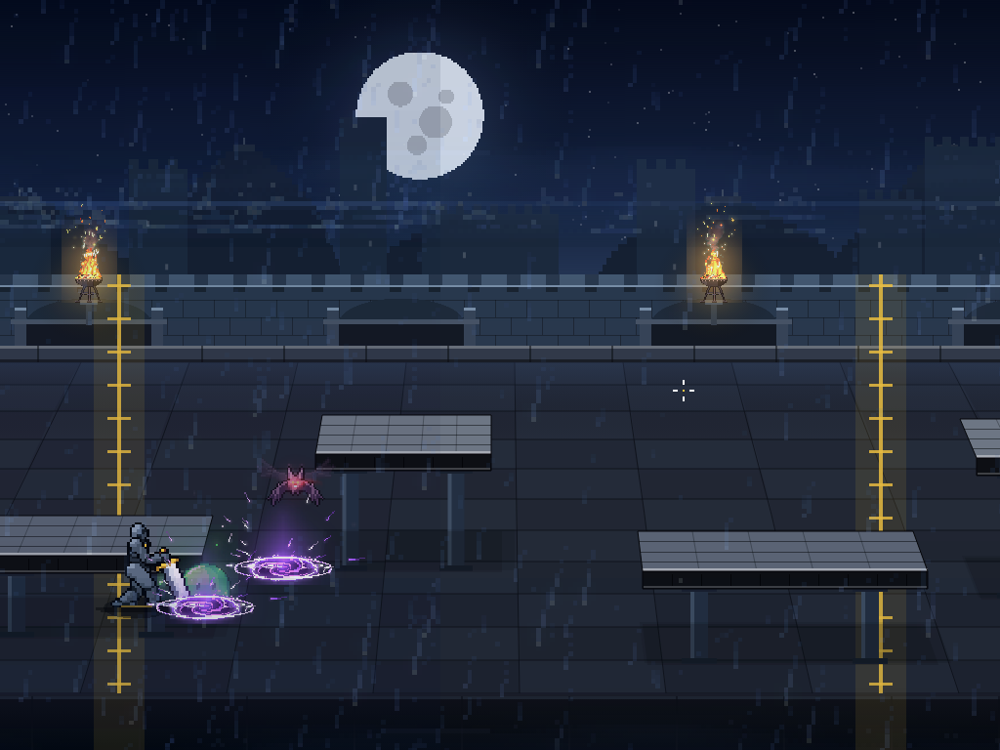

# SURVIVE — The Hollow Street

A **semi-3D (2.5D) side-view action platformer-brawler** that ships as **one
`index.html`** — no build step, no bundler, no framework.

You are dropped onto a stone street that recedes toward a real horizon. Enemies
walk in from the depth lane, hoppers bounce, fliers hover above the paving, and a
stage boss waits at the far end of the road. Everything you see is drawn by
[`patch-gg/pixelfx`](https://github.com/patch-gg/pixelfx) modules baked once into
offscreen atlases at boot and then blitted with `drawImage` — no primitive boxes,
no sprite sheets, no CDN. `imageSmoothingEnabled` is off on every canvas.



---

## The stage

The frame is split at exactly **45 %**: sky above, walkable street below.

| Layer | Motion | What it is |
|---|---|---|
| Sky | static | Baked gradient, moon/sun with glow, nebula, stars, gentle colour banding |
| Far silhouettes | **0.25×** | Castle spires, ruined towers, mountains — cut out of the universe's far tone |
| Back wall | **0.75×** | Stone wall with arches, columns, a parapet and animated `fire/brazier` torches |
| Curb | **1.0×** | Stone lip that marks the horizon and catches the wall's shadow |
| Street | **1.0×** | Perspective paving: seam grid, per-tile shading, aerial haze toward the curb |
| Platforms | 1.0× | 8 raised decks with a lit top face, a 3D front thickness edge, support pillars and a cast shadow on the street |
| Entities | 1.0× | Depth-sorted by `y` every frame, so a fighter behind a deck is *behind* it |

The street is **`stageWidth = 3600`** px wide and the camera only moves
horizontally (`camX`), with a light vertical look-up that follows you when you
jump high. Platforms sit at **`z = 75 … 155`**, each 4 px of depth tolerance per
level. Ground/wall geometry is built for the current viewport, so a resize just
rebuilds the painters.

---

## Coordinates and physics

Every actor carries three numbers:

```
x    position along the street (0 … 3600)
y    position across the depth lane (FLOOR_TOP … FLOOR_BOTTOM)
z    height above the street (0 = grounded, up is +)
```

`y` sorts and `z` draws: an actor is blitted at `(x, y - z)` and its contact
shadow at `(x, y)`, scaled by `depthScale = lerp(0.86, 1.04, v)` so the far lane
reads smaller than the near lane. Shadows are soft dark ellipses, never a
`fillRect`.

| Constant | Value |
|---|---|
| `STAGE_W` | 3600 |
| `SPEED_X` / `SPEED_Y` | 268 / 200 |
| `JUMP_VZ` / `DOUBLE_JUMP_VZ` | 580 / 545 |
| `GRAVITY` | 1550 |
| `HITSTOP` | 0.04 s on heavy hits, plus a camera punch |
| `DEPTH_TOL` / `HEIGHT_TOL` | 44 / 60 px of hit tolerance |

Landing is solved against the platform decks under you: a deck only catches you
if you fall onto its top face while your depth `y` is inside its footprint.
**S + SPACE** drops through the deck you are standing on.

---

## Classes and the four-slot kit

Four classes, each with a real z-axis kit (air juggles, ground slams, launch
recoil). **SHIFT** / **Q** / **E** / **R** are the four slots, **LMB** is your
ground attack and the same button in the air is an air attack.

| Class | LMB / Air | SHIFT · 3 s | Q · 5 s | E · 10 s (LV 3) | R (LV 5, charge meter) |
|---|---|---|---|---|---|
| **Vanguard Knight** | `moves/sword-combo` · `moves/ground-pound` + `impacts/ground-slam` | `moves/dash-strike` | `melee/uppercut` *(launch vz 430)* | `moves/earth-stomp` + `nature/quake` | `moves/holy-smite` + `holy/holy-pillar` |
| **Gunslinger** | `moves/pistol-shots` + `projectiles/bullet-tracer` | dodge roll + `explosions/smoke-bomb` | `explosions/grenade` *(bounces)* | `moves/rocket-launcher` + `explosions/big-explosion` *(recoil throws you onto ledges)* | `projectiles/muzzle-smg` × 8 |
| **Chrono Mage** | `moves/fireball-throw` + `arcane/arcane-orb` | `arcane/blink-out` → `blink-in` | `moves/ice-lance-throw` + `ice/freeze` / `ice/ice-shatter` | `moves/lightning-call` + `lightning/chain-lightning` | `moves/meteor-call` + `arcane/time-stop` |
| **Rift Sniper** | `moves/arrow-shot` + cyan `projectiles/laser-bolt` | `scifi/warp-out` → `warp-in` | `scifi/laser-grid` *(snare)* | `arcane/arcane-beam` *(piercing rail)* | `scifi/emp-blast` + `lightning/lightning-strike` |

A cast always does all five things: animates the rig on its own baked clip,
spawns the pixelfx performance, applies hit-stop and camera punch when it lands
hard, floats a callout, and starts a white pixel-font cooldown countdown
(`4.9s`) on its HUD slot.

**Progression** — `XP_STEPS = [0, 6, 16, 30, 50]` → **LV 5**. SHIFT and Q are
live from LV 1, E unlocks at **LV 3**, R at **LV 5**. The ultimate is not on a
timer: it charges **+8 % per hit** and **+15 % per kill**, glows gold at 100 %,
and empties when you use it.

---

## Enemies, waves, boss

| Enemy | Kit | HP / speed | Behaviour |
|---|---|---|---|
| Slime | `critters/slime` | 8 / 58 | Hops along the lane, squash-and-rise arc |
| Frog | `critters/frog` | 9 / 74 | Long hops that clear the near lane |
| Bat | `critters/bat` | 6 / 104 | Flies at `z 60 … 110`, dips to bite |
| Eyeball | `critters/eyeball` | 7 / 86 | Hovers at `z ≈ 106`, tracks you |
| Flying skull | `critters/flying-skull` | 10 / 92 | Weaves, then dives |
| **The Hollow Warden** | `critters/ghost` + rune circle | `110 + 12 × LV` | Stage boss: hovers, bolt volleys, slam waves; own health bar |

Three **arena gates** lock the street when you walk in (camera clamped, gold
posts at both edges) and only open when the waves are down:

| # | Arena | Waves | Pool |
|---|---|---|---|
| 0 | **THE LOWER STREET** | 2 | slime, frog |
| 1 | **THE BROKEN STAIR** | 3 | slime, frog, bat, eyeball |
| 2 | **THE HOLLOW GATE** | 2 + boss | bat, eyeball, skull, frog |

Kills drop gems and XP motes that drift toward you; the HUD counts combo pips
beside the ability bar.

---

## Six universes

`setUniverse(i)` re-tints the sky, the far silhouettes, the wall, the paving and
the weather in one frame. Weather is a pixelfx field capped at **0.15 alpha** so
it never hides the fight.

| # | Universe | Body | Weather |
|---|---|---|---|
| 1 | **MEDIEVAL 1347** | moon | `weather/rain` 0.12 |
| 2 | **ANCIENT EGYPT** | sun | `weather/fog` 0.14 |
| 3 | **FEUDAL JAPAN** | blood moon | `weather/cherry-blossoms` 0.15 |
| 4 | **POST-APOCALYPSE** | dust sun | `weather/storm` 0.13 |
| 5 | **DEEP SPACE** | ringed planet | `weather/shooting-stars` 0.14 |
| 6 | **THE VOID** | eclipse | `weather/aurora` 0.15 |

---

## Controls

| Input | Action |
|---|---|
| **A / D** | run left / right |
| **W / S** | move across the depth lane (toward / away from the camera) |
| **SPACE** | jump, again in the air for a double jump |
| **S + SPACE** | drop through the platform under you |
| **LMB** | ground attack · air attack while airborne |
| **SHIFT** | mobility slot (dash / roll / blink / warp — invincible while it runs) |
| **Q / E / R** | tactical / heavy / ultimate |
| **`** or **~** | open the dev bar |

### Dev bar (top right)

`[Switch Class]`, `[Universe 1–6]`, `[Unlock All + Fill Ult]`, `[God Mode]`,
`[Spawn Wave]`, `[Spawn Boss]`, `[Reset CDs]`. The same actions are exposed on
`window.__SURVIVE` (`setClass`, `setUniverse`, `unlockAll`, `toggleGod`,
`spawnWave`, `spawnEnemy`, `devBoss`, `resetCds`, `castSlot`, `gainXp`, `gainUlt`,
`step`, `state`) for scripted runs.

---

## Running it

The page imports the vendored engine with real ES modules, so it must be served
over HTTP — `file://` will not do:

```bash
python3 -m http.server 8080     # then open http://localhost:8080/index.html
```

First boot bakes 75 clips (≈5 s on a laptop) behind a progress bar; every frame
after that is pure `drawImage` blits.

---

## Verification

`tools/pfx-harness` boots the real `index.html` in jsdom with a recording canvas
stub and drives it through its own listeners and the `__SURVIVE` hook:

```bash
cd tools/pfx-harness && npm install
node run.mjs
```

It fails the build on: a boot error, an unresolved effect id, a class slot that
does not animate, a hit that does not land damage, a heavy hit without 40 ms
hit-stop, a broken arena wave count, a boss that will not die, a HUD slot without
its countdown, or a dev-bar button that does nothing. Current run:
**54 checks, ALL CHECKS PASSED**.

Layout: `index.html` (page shell, CSS, HUD markup, engine module) ·
`vendor/pixelfx/src` (vendored renderer) · `docs/PIXELFX-ARCHITECTURE.md` ·
`tools/pfx-harness` · `platformer-test.html` (earlier side-scrolling prototype,
kept for reference).

---

## Credits

Renderer: [`patch-gg/pixelfx`](https://github.com/patch-gg/pixelfx) (vendored
under `vendor/pixelfx`, unmodified). Every visual in the game — characters,
critters, platforms, weather, pickups, projectiles, text — comes from its effect
manifests.
