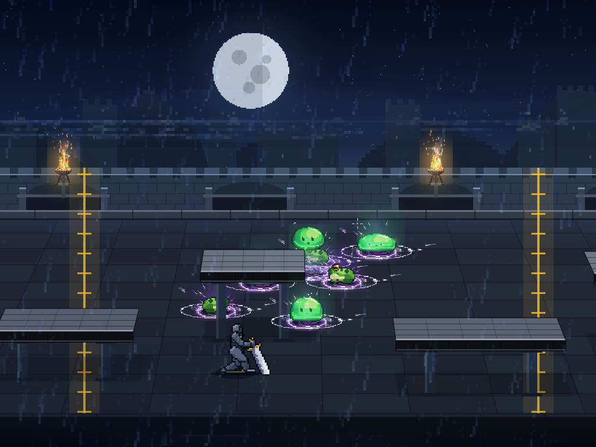

# SURVIVE — The Hollow Street

A **semi-3D (2.5D) side-view action platformer-brawler**: seven classes, a
3600 px stone street that recedes to a real horizon, raised decks you can fight
on and drop through, arena gates that slam shut behind you, and a stage boss that
changes phase as it dies.

No build tools, no bundler, no framework. The page is native ES modules
(`<script type="module" src="./src/main.js">`) so it runs as-is on GitHub Pages,
on `python3 -m http.server`, or anywhere else that serves files over HTTP.

Every visual — fighters, critters, bosses, platforms, torches, weather, pickups,
projectiles, damage numbers — comes from the vendored
[`patch-gg/pixelfx`](https://github.com/patch-gg/pixelfx) renderer, baked once
into offscreen atlases at boot and blitted with `drawImage`.
`imageSmoothingEnabled` is off on every canvas.



---

## The stage

The viewport splits at a **46 % horizon**: sky above, walkable street below.

| Layer | Scroll | What it is |
|---|---|---|
| Sky | — | Baked gradient, stars/nebula, moon or sun with halo |
| Far skyline | **0.25×** | Mountain cones and silhouettes |
| Mid skyline | **0.42×** | Castle towers, keeps and ruins (kept clear of the moon) |
| Back wall | **0.75×** | Stone battlement: courses, blind arches, columns, animated `fire/brazier` torches |
| Curb | 1.0× | The stone lip that marks the horizon |
| Street | 1.0× | Perspective paving: converging joints, per-tile shading, depth haze |
| Platforms | 1.0× | 9 raised decks with a lit top face, a 3D front lip, pillars to the floor and cast shadows |
| Actors | 1.0× | Depth-sorted by `y` every frame, so you can stand in front of *or* behind a deck |

The street spans **`stageWidth = 3600`**, decks hang at **`z = 75 … 155`**, and
three **arena gates** lock the road when you walk in — amber barrier columns at
both edges, camera clamped between them, dissolving with a blinking `GO →` when
the wave is dead.

Support beacons and spawns use `spawn/spawn-portal`; blows land with
`impacts/hit-spark` / `impacts/crit-hit` plus `ui/damage-number`; deaths burst
with `spawn/shatter-death` and drop bouncing `pickups/xp-orb` / `pickups/gem-spin`.

---

## Coordinates and physics

```
x    along the street        (0 … 3600)
y    across the depth lane   (FLOOR_TOP … FLOOR_BOTTOM)
z    height above the street (0 = grounded)
```

Actors are blitted at `(x, y - z)` with a crisp elliptical contact shadow at
`(x, y)`, scaled by `depthScale = lerp(0.86, 1.04, v)` so the back of the lane is
smaller than the front.

| Constant | Value |
|---|---|
| `SPEED_X` / `SPEED_Y` | 268 / 200 |
| `JUMP_VZ` / `DOUBLE_JUMP_VZ` | 580 / 545 |
| `GRAVITY` | 1550 |
| `HITSTOP` | 0.04 s (+ camera punch) |
| hit tolerance | `DEPTH_TOL 44` / `HEIGHT_TOL 60` |
| horizon | 46 % of the viewport |

Landing is solved against the deck under you: it only catches you when you are
falling onto its top face with your depth `y` inside its footprint. **S + SPACE**
drops through it.

---

## The four-slot kit

Every class has **LMB** (a different move in the air), **SHIFT** (mobility,
2.5–4 s), **Q** (tactical, 4–6 s), **E** (heavy, LV 3, 8–12 s) and **R**
(ultimate, LV 5). A cast animates the rig on its own baked clip, fires its
pixelfx performance, applies hit-stop + shake when it lands hard, floats a
callout, and starts a white pixel countdown (`4.2s`) on its slot.

The ultimate is not a timer: it charges **+8 % per hit** and **+15 % per kill**,
glows gold at 100 %, and empties when used.

| Class | LMB / Air | SHIFT | Q | E · LV 3 | R · LV 5 |
|---|---|---|---|---|---|
| **Vanguard Knight** | `moves/sword-combo` · `moves/ground-pound` | `moves/dash-strike` | `melee/uppercut` *(launch 430)* | `moves/earth-stomp` + `nature/quake` | `moves/holy-smite` + `holy/holy-pillar` |
| **Gunslinger** | `moves/pistol-shots` + `projectiles/bullet-tracer` | dodge roll + `explosions/smoke-bomb` | `explosions/grenade` *(bounce)* | `moves/rocket-launcher` + `explosions/big-explosion` *(recoil)* | `projectiles/muzzle-smg` × 8 |
| **Chrono Mage** | `moves/fireball-throw` + `arcane/arcane-orb` | `arcane/blink-out` → `blink-in` | `moves/ice-lance-throw` + `ice/freeze` | `moves/lightning-call` + `lightning/chain-lightning` | `moves/meteor-call` + `arcane/time-stop` |
| **Rift Sniper** | `moves/arrow-shot` + `projectiles/laser-bolt` | `scifi/warp-out` → `warp-in` | `scifi/laser-grid` *(snare)* | `arcane/arcane-beam` *(rail)* | `scifi/emp-blast` + `lightning/lightning-strike` |
| **Berserker** | `melee/heavy-cleave` · `melee/hammer-smash` | berserk leap (`moves/ground-pound`) | `melee/spin-slash` | `moves/ground-pound` + `fire/fire-ring` | `status/rage` + `fire/fire-tornado` *(+40 % damage)* |
| **Shadow Assassin** | `melee/dagger-flurry` | `shadow/shadow-flames` blink | `shadow/grasping-hands` *(root)* | `shadow/void-orb` + `shadow/dark-explosion` | `shadow/black-hole` + `shadow/necro-skulls` |
| **Tech Specialist** | bouncing `projectiles/energy-disc` | `scifi/jetpack` boost | `scifi/force-field` *(dome)* | `scifi/tractor-beam` + `explosions/plasma-explosion` | `scifi/energy-core` + `explosions/nuke` |

**Progression** — `XP_STEPS = [0, 6, 16, 30, 50]` → **LV 5**; E opens at LV 3,
R at LV 5. Clearing an arena gate drops three **Data Chip** cards (pick one with
a click or `1` / `2` / `3`): extra HP, +15 % damage, +10 % speed, +25 % ultimate
charge or −20 % cooldowns.

---

## Enemies & bosses

| Enemy | Kit | HP / speed | Behaviour |
|---|---|---|---|
| Slime | `critters/slime` | 8 / 58 | Hops along the lane |
| Frog | `critters/frog` | 9 / 74 | Long hops |
| Bat | `critters/bat` | 6 / 104 | Flies at `z 60–110` |
| Eyeball | `critters/eyeball` | 7 / 86 | Hovers, tracks you |
| Flying skull | `critters/flying-skull` | 10 / 92 | Weaves and dives |
| **The Hollow Warden** | `critters/ghost` + rune circle | `110 + 12 × LV` | Stage boss with three phases |

The warden is a real fight: **phase 1** hurls three-bolt volleys, **phase 2**
widens the spread and slams the street, **phase 3** speeds up and summons a
skull escort — each shift announced with a banner, a blast and a camera kick.

| # | Arena | Waves | Pool |
|---|---|---|---|
| 0 | **THE LOWER STREET** | 2 | slime, frog |
| 1 | **THE BROKEN STAIR** | 3 | slime, frog, bat, eyeball |
| 2 | **THE HOLLOW GATE** | 2 + boss | bat, eyeball, skull, frog |

---

## Six universes

`setUniverse(i)` repaints the sky, both skylines, the wall, the paving and the
weather in one frame. Weather is capped at **0.15 alpha** so it never hides the
fight.

| # | Universe | Body | Weather |
|---|---|---|---|
| 1 | **MEDIEVAL 1347** | moon | `weather/rain` |
| 2 | **ANCIENT EGYPT** | sun with rays | `weather/fog` |
| 3 | **FEUDAL JAPAN** | blood moon | `weather/cherry-blossoms` |
| 4 | **POST-APOCALYPSE** | dust sun | `weather/storm` |
| 5 | **DEEP SPACE** | ringed planet | `weather/shooting-stars` |
| 6 | **THE VOID** | eclipse + nebula | `weather/aurora` |

---

## Controls

| Input | Action |
|---|---|
| **A / D** | run along the street |
| **W / S** | move across the depth lane |
| **SPACE** | jump · again in the air for a double jump |
| **S + SPACE** | drop through the deck under you |
| **LMB** | ground attack · air attack while airborne |
| **SHIFT** | mobility (dash / roll / blink / warp / leap — invincible while it runs) |
| **Q / E / R** | tactical · heavy · ultimate |
| **1 / 2 / 3** | pick a Data Chip when a draft is open |
| **`** or **~** | open the dev panel |

### Dev panel (top right, clear of the HUD)

`[Switch Class]` (all seven) · `[Universe 1–6]` · `[+1 Level]` ·
`[Unlock All + Fill Ult]` · `[God Mode]` · `[Spawn Wave]` · `[Spawn Boss]` ·
`[Reset Cooldowns]` · `[Wipe Map]`.

The same actions are on `window.__SURVIVE`: `setClass`, `setUniverse`, `unlockAll`,
`toggleGod`, `spawnWave`, `spawnEnemy`, `devBoss`, `resetCds`, `wipeMap`,
`openCards`, `takeCard`, `castSlot`, `gainXp`, `gainUlt`, `step`, `state`.

---

## Running it

```bash
python3 -m http.server 8080     # → http://localhost:8080/index.html
```

The page **must be served over http** — opening `index.html` from disk (`file://`)
makes browsers refuse ES modules. First boot fetches ~290 modules, then bakes 112
clips behind a progress bar that keeps animating; after that a frame is pure
`drawImage` blits.

### If the boot screen does not move

It can no longer stay silent: an inline guard in `index.html` runs before the
engine and writes the reason into `#bootMsg`.

| What you see | What it means |
|---|---|
| amber `Opened from file://` | you double-clicked the file — serve it instead |
| red `Could not load …/src/main.js` | wrong server root, a 404, or a server sending `text/plain` for `.js` |
| red `Boot error: …` | a throw inside a module, with the file and line |
| amber `Still loading the engine modules (6s)…` | the ~290 module requests are slow (proxy/network); it is working |
| red `Engine never started after 20 s` | the module graph never arrived — check the console |
| red `Baked N clips, M failed` | one manifest failed to bake; the rest of the game still boots |

---

## Verification

Four harnesses, all runnable from the repo root:

```bash
npm install                       # jsdom, once (inside tools/pfx-harness)
npm test                          # behaviour: imports src/main.js, 65 checks
npm run test:guard                # the inline boot guard: file://, throws, 404s
npm run test:graph                # walks the module graph over HTTP
npm run test:browser              # cold boot over HTTP, then link and boot
```

```
npm test              → 65 checks · --- ALL CHECKS PASSED ---
npm run test:guard    →  9 checks · --- ALL CHECKS PASSED ---
npm run test:graph    → 287 modules, 0 problems · --- GRAPH OK ---
npm run test:browser  → linked 1.5 s, boot 7.3 s · --- BROWSER BOOT OK ---
```

`test:browser` is the one that behaves like a real browser: it registers an ESM
loader that fetches every module over HTTP and **refuses anything not served as
JavaScript** — the rule that silently kills module scripts — then links the graph
and boots the page, asserting the overlay dismisses, the bar reaches 100 %, the
seven class chips exist, the bake reports, a frame renders and the console stays
clean. `test:graph` is the same audit without a DOM, so it can be pointed at any
deployment.

`npm test` fails on: a boot error, an unresolved effect id, any of the 7 classes ×
4 slots failing to animate, a hit that deals no damage, a heavy hit without
exactly 40 ms hit-stop, a broken wave count, a card draft that will not open, a
boss that will not die, a HUD slot without its countdown, or a dev button that
does nothing.

Pixels were verified separately against a real rasteriser (all six universes,
every class mid-cast, the boss fight, the card draft).

---

## Layout

```
index.html                 page shell: canvas, retro HUD, title/class overlay, dev panel
src/main.js                loop, input, audio blips, depth-sorted render list, boot
src/core.js                constants, viewport, shared state, math helpers (imports nothing)
src/pfx.js                 pixelfx loader + id verification + atlas baker + fx pool
src/world.js               six universes, parallax, wall, street, decks, gates, weather, camera
src/classes.js             seven classes, the 4-slot kit, z-axis combat, physics
src/enemies.js             critters, boss phases, wave spawner, arena flow
src/ui.js                  HUD, ability bar, callouts, Data Chip cards, dev panel
vendor/pixelfx/            the vendored renderer (unmodified)
tools/pfx-harness/         jsdom verification harness
legacy-topdown.html        the previous top-down engine, kept for reference only
platformer-test.html       the earlier side-scrolling prototype, reference only
```

Module graph (strictly one-way):

```
core → pfx → world → classes → enemies / ui → main
```

`core.js` also exposes a `bus` for the handful of upward notifications (callout,
banner, denial, cards), which is what keeps `classes` from importing `ui`.

---

## Credits

Renderer: [`patch-gg/pixelfx`](https://github.com/patch-gg/pixelfx), vendored
under `vendor/pixelfx`, unmodified.
